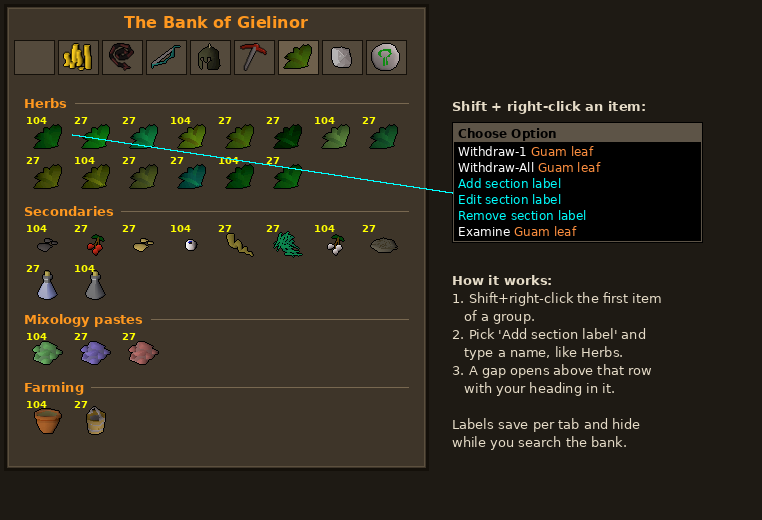

# Bank Section Labels

Headings and your own grid inside the regular Old School RuneScape bank.

*Mockup, not an in-game screenshot.*

In-game shots to add later: `docs/numbered-tab.png`, `docs/all-items.png`.

## Features

- Section headings in any normal bank tab
- Tab titles on the all-items view
- Free grid placement, with gaps for armor sets
- Drag to arrange
- Rename tab titles and sections
- Per-heading colors, using RuneLite’s color wheel
- Compact and reset
- Works alongside Bank Tags and Bank Tab Names
- Skips Bank Tag Layouts tabs

## How to use

1. Shift-right-click an item and choose **Add section label**.
2. Drag items into the cells. Holes between pieces stay; unused space closes when you let go.
3. Right-click a bank tab button and choose **Rename tab title**.
4. Shift-right-click a heading and choose **Change color**.
5. Shift-right-click for **Compact section** or **Reset section labels**.

Search, tag tabs, and potion storage are left as the game drew them.

## Settings

| Setting | What it does |
| --- | --- |
| Show section labels | Headings and the space they need |
| Require Shift for label menu | Hide add, edit, and remove unless Shift is held |
| Tab title color | Default color of numbered-tab titles |
| Section heading color | Default color of section headings |
| Divider line color | Thin line under a heading |
| Font | RuneLite font for the text |
| Divider line | Turn that line on or off |
| Header background | Dark bar behind the text. Off by default |
| Header height | Space above a labeled row |
| Show tab titles | Titles above each numbered tab on the all-items view |
| Show empty cells in all-items view | Off packs each row. On shows the same holes as a numbered tab |
| Reset open tab's sections | Clears that tab, then turns itself off |

Names and layouts are saved per account.

## Notes

Dropping an item onto a section in a **different** vanilla tab does the same thing as dragging that item onto the tab button: the client’s normal bank drag moves it into that tab, and this plugin then remembers the cell. Same-tab drops only change the saved layout and do not rearrange the bank on the server.

## Develop

Java 11. From this directory, `./gradlew run` starts the example-plugin test client (`--developer-mode`). `./gradlew build` compiles and runs the tests.

`runelite-plugin.properties` uses `build=standard`, so a Plugin Hub build replaces `build.gradle`. The local `shadowJar` task is not part of `build` and is not used by the hub.
